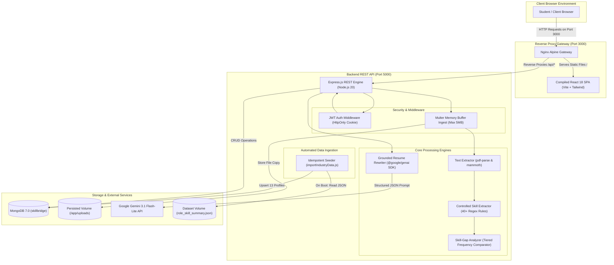
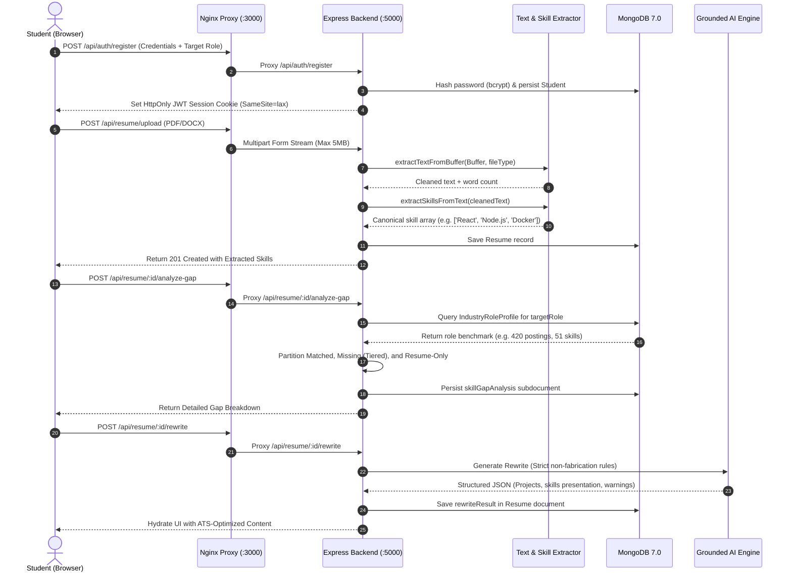
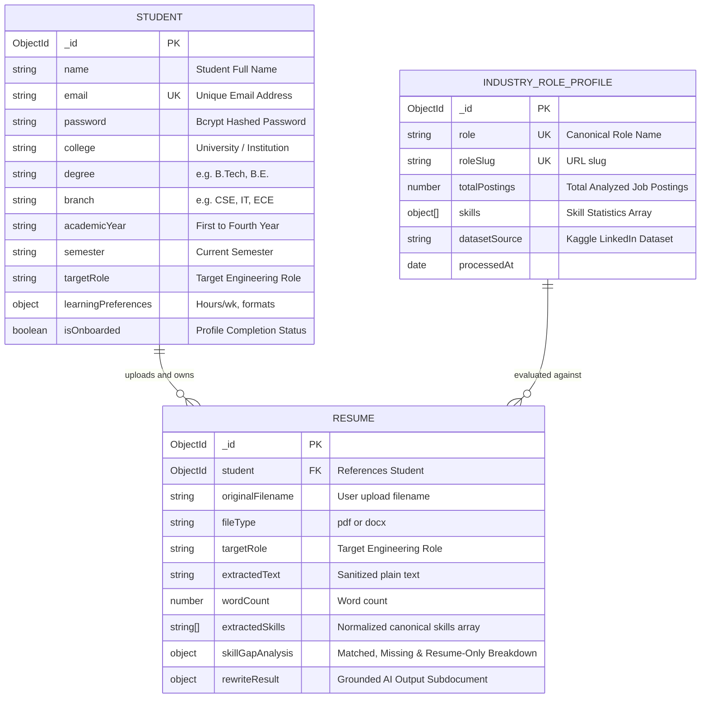

<div align="center">

# 🚀 SkillBridge

### Next-Generation Skill-Gap Analysis & Career Readiness Platform for Engineering Students

[](https://nodejs.org/)
[](https://react.dev/)
[](https://vitejs.dev/)
[](https://tailwindcss.com/)
[](https://www.mongodb.com/)
[](https://www.docker.com/)
[](https://nginx.org/)

<br/>

> **SkillBridge** bridges the gap between academic engineering curriculums and live tech hiring standards. By pairing **real-world LinkedIn industry posting benchmarks (3,800+ postings across 13 engineering roles)** with **deterministic resume text extraction** and **strictly grounded AI-assisted resume rewriting**, SkillBridge delivers transparent, non-hallucinated career intelligence to undergraduate engineers.

<br/>

[Key Capabilities](#03-our-solution) • [System Architecture](#04-system-architecture) • [How It Works](#05-how-it-works) • [Core Features](#06-core-features) • [Quickstart Guide](#12-installation-and-setup) • [Verification & Testing](#11-testing-and-validation)

---

</div>

## 📑 Table of Contents

- [01. Project Overview](#01-project-overview)
- [02. The Problem Statement](#02-the-problem-statement)
- [03. Our Solution](#03-our-solution)
- [04. System Architecture](#04-system-architecture)
- [05. How It Works (End-to-End Pipeline)](#05-how-it-works-end-to-end-pipeline)
- [06. Core Features](#06-core-features)
- [07. Technology Stack](#07-technology-stack)
- [08. Repository Structure](#08-repository-structure)
- [09. Data Flow, Schemas & Algorithms](#09-data-flow-schemas--algorithms)
- [10. User Interface & Visual Tour](#10-user-interface--visual-tour)
- [11. Testing & Verification Suite](#11-testing--verification-suite)
- [12. Installation & Setup](#12-installation--setup)
- [13. Example Usage & API Tour](#13-example-usage--api-tour)
- [14. Current Limitations vs. Roadmap](#14-current-limitations-vs-roadmap)
- [15. Security & Privacy Posture](#15-security--privacy-posture)
- [16. Contributing Guidelines](#16-contributing-guidelines)
- [17. Acknowledgements & Data Sources](#17-acknowledgements--data-sources)

---

## 01. Project Overview

**SkillBridge** is a containerized, full-stack career readiness platform engineered specifically for engineering and computer science undergraduates. Rather than relying on generic black-box keyword matching, SkillBridge anchors student skills to **empirical hiring benchmarks extracted from 123,800+ Kaggle LinkedIn job records**.

```
┌──────────────────────┐         ┌──────────────────────┐         ┌──────────────────────┐
│  3,800+ Real Job     │         │ Deterministic Regex  │         │ Grounded AI Engine   │
│  Postings Mined      │ ──────> │ Multi-Format Resume  │ ──────> │ Strict Anti-         │
│  Across 13 Tech Roles│         │ Skill Extraction     │         │ Hallucination Rewrite│
└──────────────────────┘         └──────────────────────┘         └──────────────────────┘
```

The system ingests student resumes (`.pdf` and `.docx`), executes memory-isolated text extraction, identifies technical proficiencies across 40+ canonical skill taxonomies, calculates statistical skill gaps against market demand frequencies, and generates ATS-optimized project rewrites without ever fabricating metrics, employers, or unearned skills.

---

## 02. The Problem Statement

- **Academic Disconnect**: University curriculums prioritize theoretical foundations (compiler design, automata theory) while entry-level hiring evaluates applied ecosystems (`Docker`, `REST APIs`, `React`, cloud platforms, and microservices).
- **The LLM Hallucination Trap**: Generic AI resume tools invent fictitious metrics (e.g., *"Scaled Redis cache by 45% for 100k users"* on sophomore course projects) and unearned tech stacks, causing students to fail technical interviews.
- **Black-Box Keyword Matchers**: Commercial ATS checkers provide arbitrary compatibility scores without actionable, data-backed market context.
- **Target Audience**: Engineering undergraduates, campus placement cells, and early-career software job seekers.

---

## 03. Our Solution

- 📊 **Empirical Market Ground Truth**: 13 career roles with 507 skill frequency benchmarks derived from 3,804 unique engineering job postings.
- 🎯 **Transparent 3-Way Skill Partitioning**:
  - **Matched Skills**: Validated in both the resume and the target industry benchmark.
  - **Missing Skills**: Industry technologies absent from the resume, classified into: **High Frequency ($\ge 30\%$)**, **Moderate Frequency ($15\text{--}29\%$)**, and **Specialized ($< 15\%$)**.
  - **Resume-Only Skills**: Valuable supplementary student competencies that differentiate the applicant.
- 🛡️ **Zero-Hallucination AI Architecture**: Strict non-fabrication prompt boundaries: zero synthetic metrics, zero invented history, zero unearned skills, and mandatory verification warnings.
- 🔒 **Enterprise-Grade Infrastructure**: Containerized 3-tier architecture with an Nginx reverse proxy eliminating CORS and third-party cookie restrictions, paired with JWT authentication via `HttpOnly` cookies.

---

## 04. System Architecture



---

## 05. How It Works (End-to-End Pipeline)



### Processing Stages
1. **Industry Data Ingestion**: `importIndustryData.js` automatically executes on backend boot via Docker CMD, idempotently upserting 13 industry role profiles from `role_skill_summary.json` into MongoDB.
2. **Authentication & Session Security**: Passwords hashed with `bcryptjs` (salt 10). Issues signed JWT inside an `HttpOnly`, `SameSite=lax` cookie, securing sessions against XSS.
3. **Multi-Format Text Ingestion**: Buffers `.pdf` and `.docx` files in memory. Parses `.pdf` via `pdf-parse` using isolated unpooled `Uint8Array` buffers and `.docx` via `mammoth`. Sanitizes whitespace and rejects non-OCR/empty files (< 15 characters).
4. **Deterministic Skill Extraction**: Evaluates text against 40+ canonical regex rules. Employs contextual guards for single-letter and common words (`C`, `R`, `Go`) and normalizes aliases (`ReactJS` $\rightarrow$ `React`, `NodeJS` $\rightarrow$ `Node.js`, `k8s` $\rightarrow$ `Kubernetes`).
5. **Skill-Gap Analysis**: Partitions skills against real MongoDB posting counts into Matched, Missing (High $\ge 30\%$, Moderate $15\text{--}29\%$, Specialized $< 15\%$), and Resume-Only differentiators.
6. **Grounded AI Rewrite**: Refactors projects and experience into STAR/XYZ bullet points with strong technical verbs, groups skills into ATS presentation blocks, and enforces a mandatory non-fabrication warning.

---

## 06. Core Features

### 1. Empirical Career Explorer (13 Roles, 3,800+ Postings)
Browse live hiring demands across 13 engineering career roles: *Full Stack Developer, Frontend Developer, Backend Developer, Software Engineer, Data Scientist, Data Analyst, Machine Learning Engineer, AI Engineer, DevOps Engineer, QA Automation Engineer, Mobile Developer, Java Developer, and Python Developer*. Includes real-time search, sorting, and frequency tier filtering.

### 2. Multi-Format Resume Ingestion & Text Inspection
Direct upload of PDF and DOCX documents (up to 5MB) handled through `multer.memoryStorage()`. Provides immediate word count, character count, and structured text inspection.

### 3. Context-Aware Skill Extractor (Zero False Positives)
Curated dictionary of 40+ regex patterns with negative lookaheads and lookbehinds. Words like "Section C", "Grade C", or "Let's go" produce zero false-positive skill detections.

### 4. Visual Skill-Gap Radar & Frequency Tiering
Interactive Recharts bar visualizations comparing candidate skills directly against posting percentages (e.g., 420 postings for Full Stack Developer), categorizing gaps into High ($\ge 30\%$), Moderate ($15\text{--}29\%$), and Specialized ($< 15\%$).

### 5. Grounded AI Resume Rewriter
One-click ATS optimization using Google Gemini 3.1 Flash-Lite (`@google/genai` SDK Interactions API). Extracts every personal/academic project, rewrites bullet points with strong technical verbs, and outputs clean ATS categories with copy-to-clipboard markdown support.

### 6. Academic Roadmaps & Curated Free Learning Resources
Semester-by-semester milestone roadmaps aligned with college academic terms, paired with 100% free learning resources (MDN, freeCodeCamp, official docs) mapped directly to missing skills.

---

## 07. Technology Stack

| Category | Technology | Version | Purpose & Application |
| :--- | :--- | :--- | :--- |
| **Frontend Framework** | **React** | `^18.3.1` | Component-based UI powering student and public views |
| **Build Tooling** | **Vite** | `^5.4.11` | Rapid HMR and optimized production asset bundling |
| **Styling** | **Tailwind CSS** | `^3.4.1` | Responsive utility-first styling and theme tokens |
| **Icons & Visuals** | **Lucide React** | `^0.460.0` | Clean iconography across dashboards and status badges |
| **Data Visualization** | **Recharts** | `^2.13.3` | Interactive SVG bar charts for skill frequency comparisons |
| **Routing** | **React Router DOM** | `^6.28.0` | Client-side routing, protected views, and query sync |
| **Backend Runtime** | **Node.js** | `20-alpine` | High-performance asynchronous JavaScript engine |
| **Server Framework** | **Express.js** | `^4.21.2` | RESTful API routing, controllers, and middleware |
| **Database & ODM** | **MongoDB & Mongoose** | `7.0` / `^8.9.5` | Document persistence, schema validation, and indexing |
| **AI Rewrite Engine** | **Google Gemini** | `gemini-3.1-flash-lite` | Structured resume rewriting via `@google/genai` (`^3.3.0`) |
| **Document Parsing** | **pdf-parse & mammoth** | `^1.1.1` / `^1.9.0` | Memory-isolated PDF and OpenXML DOCX text extraction |
| **File Ingestion** | **Multer** | `^1.4.5-lts.1` | In-memory multipart file streaming and size constraints |
| **Authentication** | **jsonwebtoken & bcryptjs** | `^9.0.2` / `^2.4.3` | Signed JWT generation and salted password hashing |
| **Reverse Proxy** | **Nginx** | `alpine` | Static asset serving, gzip compression, and `/api/*` proxy |
| **Containerization** | **Docker & Compose** | `3.8+` | Multi-container orchestration and volume networking |

---

## 08. Repository Structure

```text
Skill_Bridge/
├── Dockerfile                        # Multi-stage frontend build (Vite -> Nginx Alpine)
├── docker-compose.yml                # 3-tier container setup (MongoDB, Backend, Frontend)
├── nginx.conf                        # Nginx reverse proxy configuration & gzip rules
├── package.json                      # Frontend dependencies and build scripts
│
├── backend/                          # Express.js REST API Server
│   ├── Dockerfile                    # Node.js 20-alpine backend container definition
│   ├── package.json                  # Backend production dependencies and scripts
│   ├── server.js                     # Express app initialization, CORS, and HTTP listener
│   ├── config/db.js                  # MongoDB connection handler
│   ├── controllers/                  # auth, industry, profile, and resume controllers
│   ├── middleware/                   # authMiddleware (JWT) and errorMiddleware
│   ├── models/                       # Student, Resume, and IndustryRoleProfile Mongoose schemas
│   ├── routes/                       # auth, industry, profile, and resume Express routers
│   ├── scripts/importIndustryData.js # Idempotent JSON-to-MongoDB dataset importer
│   ├── utils/                        # textExtractor, skillExtractor, skillGapAnalyzer, resumeRewriter
│   └── test-*.js                     # 7 automated integration test suites
│
├── dataset/                          # Industry Job Market Dataset
│   ├── processed/
│   │   ├── role_skill_summary.csv    # Flattened CSV of 13 roles and 507 skill metrics
│   │   └── role_skill_summary.json   # JSON summary imported into MongoDB
│   └── scripts/extract_skills.py     # Streaming Python script processing Kaggle raw postings
│
└── src/                              # React 18 Single Page Application
    ├── App.jsx                       # Client-side router configuration & route guards
    ├── components/                   # common (Badge, Button, Card) and dashboard widgets
    ├── context/StudentContext.jsx    # Global auth state & session persistence
    ├── pages/                        # public (Home, Login, Register) & student (Dashboard, SkillGap)
    └── services/api.js               # Centralized fetch wrapper with HttpOnly cookie support
```

---

## 09. Data Flow, Schemas & Algorithms

### Database Entity-Relationship Model (MongoDB / Mongoose)



### Contextual Skill Ambiguity Resolution
Ambiguous single-letter and common verb tokens use contextual boundary regexes:

```javascript
// Example: Single-letter 'C' programming language pattern
{
  canonical: 'C',
  pattern: /\b(?:c\s+programming|programming\s+in\s+c|c\s+language|embedded\s+c|c\s*(?:\/|\band\b)\s*c\+\+)\b/i
}
```

### Frequency Tier Classification

$$\text{Tier}(\text{Percentage}) = \begin{cases} 
\text{High Frequency} & \text{if } P \ge 30\% \\ 
\text{Moderate Frequency} & \text{if } 15\% \le P < 30\% \\ 
\text{Specialized} & \text{if } P < 15\% 
\end{cases}$$

---

## 10. User Interface & Visual Tour

- **Landing Page (`/`)**: Overview with live statistics (**13 Career Roles**, **3,800+ Postings**), feature matrices, and quick registration.
- **Student Dashboard (`/app`)**: Career readiness gauge, active degree/semester status, and recommended next learning activity.
- **Career Explorer (`/app/careers`)**: Searchable directory of 13 engineering tracks with posting counts and skill demand rankings.
- **Resume Analyzer (`/app/skill-gap`)**: PDF/DOCX drag-and-drop upload, extracted text inspector, and Recharts skill gap visualizer.
- **AI Rewrite Studio (`/app/skill-gap?subview=rewrite`)**: STAR-formatted project rewrites, categorized skill groups, and one-click ATS markdown export.

---

## 11. Testing & Verification Suite

SkillBridge includes 7 self-contained automated test suites in the `backend/` directory:

```powershell
# In a terminal inside the backend directory:
cd backend

# 1. Verify Industry Dataset API & Idempotent Ingestion
node test-industry-api.js

# 2. Verify Regex Skill Extraction & Normalization
node test-skill-extraction.js

# 3. Verify Skill Gap Comparison Engine & Frequency Tiers
node test-skill-gap-analysis.js

# 4. Verify PDF & DOCX Upload & Text Display
node test-resume-feature.js

# 5. Verify AI Resume Rewriter & Error Handling
node test-resume-rewrite.js

# 6. Verify Complete End-to-End Frontend Flow
node test-frontend-resume-analyzer-flow.js
```

### Key Verified Behaviors
- ✅ **Idempotency**: Multiple dataset import runs produce 0 duplicate records.
- ✅ **Multi-Tenancy Security**: Cross-student access attempts return HTTP `403 Forbidden`.
- ✅ **Ambiguity Guards**: Confirms words like "Section C" or "Let's go" produce 0 false-positive skill detections.
- ✅ **Benchmark Accuracy**: Confirms Full Stack Developer benchmark uses 420 postings with JavaScript at 64.52% and React at 45.24%.

---

## 12. Installation & Setup

### Prerequisites
- **Docker Desktop** with WSL 2 backend (Windows) or Docker Engine 24+ (Linux/macOS).
- Alternatively: **Node.js 18+** and **MongoDB 7.0** for manual host execution.

---

### Method A: Docker Compose (Recommended)

#### 1. Clone & Configure
```powershell
git clone https://github.com/<YOUR_USERNAME>/Skill_Bridge.git
cd Skill_Bridge

# Copy environment template
Copy-Item .env.example .env     # Windows PowerShell
cp .env.example .env            # Linux / macOS
```

Configure your `.env` file:
```env
JWT_SECRET=your_secure_jwt_secret_phrase
CLIENT_URL=http://localhost:3000
COOKIE_SECURE=false
COOKIE_SAMESITE=lax

# Gemini API Key (Required for AI Resume Rewrite feature)
# Get your free key at: https://aistudio.google.com/
GEMINI_API_KEY=AIzaSy...your_gemini_api_key_here
GEMINI_MODEL=gemini-3.1-flash-lite
```

#### 2. Launch Containers
```powershell
docker compose up --build
```
- **Web Application Portal**: [http://localhost:3000](http://localhost:3000)
- **API Health Check**: [http://localhost:3000/api/health](http://localhost:3000/api/health)
- **Industry Roles API**: [http://localhost:3000/api/industry/roles](http://localhost:3000/api/industry/roles)

---

### Method B: Manual Host Setup (Without Docker)

#### 1. Backend Setup
```powershell
cd backend
copy .env.example .env
npm install

# Seed the 13 career roles into MongoDB
npm run import-industry

# Run backend development server
npm run dev
```

#### 2. Frontend Setup
In a new terminal at the project root:
```powershell
npm install
npm run dev
```
Open [http://localhost:3000](http://localhost:3000).

---

## 13. Example Usage & API Tour

### 1. Register a Student
```bash
curl -X POST http://localhost:3000/api/auth/register \
  -H "Content-Type: application/json" \
  -c cookies.txt \
  -d '{
    "name": "Priya Sharma",
    "email": "priya.sharma@college.edu",
    "password": "SecurePassword123!",
    "college": "National Institute of Technology",
    "degree": "B.Tech",
    "branch": "Computer Science & Engineering",
    "academicYear": "Second Year",
    "targetRole": "Full Stack Developer"
  }'
```

### 2. Upload Resume & Trigger Gap Analysis
```bash
# Upload PDF/DOCX resume
curl -X POST http://localhost:3000/api/resume/upload \
  -b cookies.txt \
  -F "resume=@resume.pdf" \
  -F "targetRole=Full Stack Developer"

# Trigger skill-gap comparison against 420 job postings
curl -X POST http://localhost:3000/api/resume/<RESUME_ID>/analyze-gap \
  -b cookies.txt \
  -H "Content-Type: application/json" \
  -d '{"targetRole": "Full Stack Developer"}'
```

### 3. Generate Grounded AI Rewrite
```bash
curl -X POST http://localhost:3000/api/resume/<RESUME_ID>/rewrite \
  -b cookies.txt \
  -H "Content-Type: application/json" \
  -d '{"targetRole": "Full Stack Developer"}'
```

---

## 14. Current Limitations vs. Roadmap

| Capability Area | Current Status (Implemented) | Upcoming Roadmap (Planned) |
| :--- | :--- | :--- |
| **Industry Benchmarks** | 13 Engineering Roles, 3,804 Postings, 507 Skills | Ingestion pipeline for periodic live job scraping |
| **Skill Extraction** | Deterministic Regex Engine (40+ canonical rules) | Hybrid Named Entity Recognition (NER) for emerging tools |
| **Skill Gap Analysis** | Tiered frequency matrix ($\ge 30\%$, $15\text{--}29\%$, $< 15\%$) | Estimated study-hour timeline to close gaps |
| **AI Resume Rewriter** | Grounded Gemini 3.1 Flash-Lite, anti-hallucination | Direct ATS PDF export with customizable LaTeX templates |
| **Roadmaps** | Semester milestone tracker with persistent local state | Dynamic roadmap generation derived directly from gap results |
| **Profile Integrations** | Manual onboarding wizard and profile settings | GitHub repo analyzer & LeetCode scraper for automated proof |

---

## 15. Security & Privacy Posture

- **Zero Hardcoded Secrets**: All JWT secrets, database connection URIs, and API keys are loaded exclusively from `.env`.
- **HttpOnly Cookies**: Session tokens cannot be accessed by client JavaScript, mitigating Cross-Site Scripting (XSS) risks.
- **Strict Data Ownership**: Resumes and analyses are indexed by `student: ObjectId`. Endpoints verify ownership (`req.student._id`), returning HTTP `403 Forbidden` on unauthorized requests.
- **Container Isolation**: Internal backend-to-database communication is isolated within Docker's bridge network (`skillbridge-network`).

---

## 16. Contributing Guidelines

1. **Fork the Repository**: Create your feature branch (`git checkout -b feature/NewCapability`).
2. **Adhere to Code Standards**: Maintain modular controllers, Mongoose schemas, and descriptive error responses.
3. **Run the Test Suite**: Ensure all 7 backend test suites pass without regression:
   ```powershell
   cd backend && node test-skill-extraction.js && node test-skill-gap-analysis.js
   ```
4. **Submit a Pull Request**: Detail your changes and include relevant test logs.

---

## 17. Acknowledgements & Data Sources

- **Kaggle**: Real-world job posting records sourced from the Kaggle LinkedIn Job Postings Dataset.
- **Google AI Studio**: Gemini 3.1 Flash-Lite model access and `@google/genai` SDK.
- **Open-Source Community**: Powered by Node.js, Express, React, Vite, Tailwind CSS, Lucide Icons, and Recharts.

---

<div align="center">
  <sub>SkillBridge — Engineered with precision for the next generation of software engineers.</sub>
</div>
